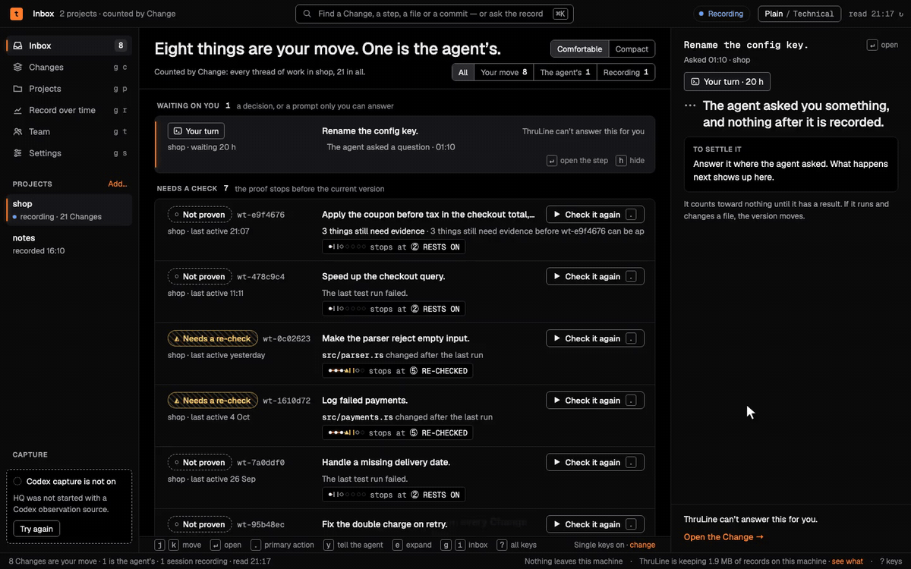

# ThruLine

ThruLine reads the session logs your AI coding agent already writes and shows, with a receipt for each line, what the agent claimed and what the record supports.


## Why it exists

An agent says "done" or "all tests pass", and that report is usually all anyone reads.
ThruLine checks each claim against your own session record and says "claimed, and no proof found in the record" when nothing backs it.
Every line it shows points to a file and line in your logs, and all of it stays on your machine.

## Install

Download one archive from the [v0.2.0 release](https://github.com/thrulinehq/thruline/releases/tag/v0.2.0) and check it against `SHA256SUMS`:

```sh
# TARGET is aarch64-apple-darwin (macOS, Apple silicon), x86_64-apple-darwin (macOS, Intel),
# aarch64-unknown-linux-musl (Linux, arm64) or x86_64-unknown-linux-musl (Linux, x86_64)
TARGET=aarch64-apple-darwin
BASE=https://github.com/thrulinehq/thruline/releases/download/v0.2.0
curl -fsSLO "$BASE/thruline-cli-$TARGET.tar.gz"
curl -fsSLO "$BASE/SHA256SUMS"
grep "thruline-cli-$TARGET.tar.gz" SHA256SUMS | shasum -a 256 -c -   # on Linux: sha256sum -c -
tar -xzf "thruline-cli-$TARGET.tar.gz"
mkdir -p ~/.local/bin && install -m 0755 "thruline-cli-$TARGET/thruline" ~/.local/bin/thruline
thruline --version
```

```
thruline 0.2.0
```

Put `~/.local/bin` on your `PATH` if it is not there.

**Build from source.** You need Rust 1.97 or newer and git. From a checkout of this repository:

```sh
cargo build --release -p thruline-cli    # writes target/release/thruline
```

The default build downloads ONNX Runtime while compiling, for the optional `annotate` command, and needs a C++ compiler (GCC 13 or newer on Linux), `pkg-config` and OpenSSL headers. Add `--no-default-features` to skip all of that, as the release archives do; `annotate` and `eval` are then unavailable.

## Quick start

```sh
thruline init                    # sets up recording for Claude Code; asks before the optional parts
claude                           # run your agent as you normally do
thruline ingest --apply          # read your session logs into the record (plain `thruline ingest` previews)
thruline why spkf_4e260dc6aba4   # the receipt behind one line; take the id from the next session's brief
thruline ui                      # open HQ in your browser; it prints the address (it tries port 7777 first)
```

`thruline init` prints each file it changed, then lines like these (some lines are left out here):

```
speaker hooks    install the in-session truth loop? [Y/n]
  wrote          SessionStart brief, Stop audit, SessionEnd digest
stop gate        not installed — add it with `thruline init --gate`
undo with        thruline init --undo
```

At the start of the next session in that project, ThruLine puts up to three receipt-backed lines in front of the agent, each ending in a `why` id. This is the top of `thruline why` on a synthetic session; the rest names the file, line and hash-chain position of the claim:

```
claimed, and no proof found in the record
  "I've added retry logic to `client.rs`."
  the claim may be entirely true — the record simply does not show it
```

## What it records, where, and what leaves your machine

- **Records.** The session logs your agent writes (Claude Code transcripts; Codex rollouts when you ingest them) and, once hooks are installed, one row per hook event: prompts, tool calls and their output. Rows go into an append-only, hash-chained SQLite ledger.
- **Where.** `~/.thruline/` (set `THRULINE_HOME` to move it), owner-only: `ledger.db`, `exec.db`, sealed copies of ingested logs in `mirrors/`, `digest/`, `export/`, and `licence.txt` once you install a licence. Hook captures mask credential-shaped values before writing, on a best-effort basis; the sealed copies and the HQ export contain your transcript text, so treat the folder like your session logs. The capture hook pack (`thruline hook-install`) and the command shim snapshot your working tree, which adds unreferenced objects to the repository's `.git/objects`; `thruline doctor` reports the size.
- **What leaves.** Nothing is sent to ThruLine or any remote host: no telemetry, no update check, no account, and no licence activation or refresh (a licence is a signed file checked on your machine). The binary opens one kind of connection, to an Ollama server on the same machine (`127.0.0.1:11434`): HQ's Settings page asks whether it is running, and `thruline annotate` (source builds only) sends it assistant messages to classify. A non-loopback address is refused. `thruline ui` listens on loopback only, and `thruline sync` refuses to run because no sync server exists. A command you ask ThruLine to run, such as `thruline check -- <command>`, runs as you and can use the network if that command does.

## Core commands (`thruline --help` lists the rest)

| Command | What it does |
| --- | --- |
| `thruline init` | Set up recording and the session-start and stop hooks for Claude Code; `--undo` reverses it |
| `thruline ingest` | Preview, then with `--apply` read existing Claude Code or Codex (`--source codex`) logs into the record |
| `thruline ui` | Open HQ in your browser |
| `thruline now` | What needs you, from the record |
| `thruline why <id>` | The receipt behind one line |
| `thruline verify` | Re-read the raw files and recompute every hash and chain link |
| `thruline doctor` | Check the install, the hooks and the record |
| `thruline upgrade` | Update the record's schema after installing a new version; other commands stop until you run it |

## Supported agents and platforms

- **Claude Code:** `thruline init`, then `thruline ingest`.
- **Codex:** `thruline hook-install --harness codex`, then trust the hook pack with `/hooks` inside Codex or Codex skips it. `thruline ingest --source codex` reads past sessions.
- **Gemini CLI:** not supported yet; the hook installer refuses.
- **Platforms:** macOS (Apple silicon, Intel) and Linux (arm64, x86_64). There is no Windows build.

## Free and Pro

| | Free | Pro |
| --- | :---: | :---: |
| Recording, ingest, hooks, HQ, `now`, `why`, `verify`, `doctor` | yes | yes |
| Re-checks, links, exports, second approvals, taking an approval back, stopping a run | yes | yes |
| Approving a version of a Change (the Approve button in HQ) | no | yes |

Only approving a version needs a licence. `thruline licence status` says which you have; `thruline licence install <file>` installs a licence file you get from [thrulinehq.com/pricing](https://thrulinehq.com/pricing).

## Status

v0.2.0. Known issues are in the [release notes](docs/release/v0.2.0-NOTES.md#known-limits).

## License

ThruLine is licensed under the [Functional Source License, Version 1.1, MIT Future License](LICENSE.md) (FSL-1.1-MIT). You may use, modify and share it for any purpose except offering a competing commercial product or service. Each release becomes available under the MIT License two years after it is published.

Third-party material keeps its own licenses and copyright notices; see [Third-party notices](THIRD_PARTY_NOTICES.md).

ThruLine records sessions of AI coding agents such as Claude Code and Codex. You must be authorized to use those agents, and any service they connect to, under their own terms. ThruLine grants no license, account, key or access to them. ThruLine Pro features, as distributed, require a paid licence from RAAS Labs, LLC. This notice does not amend the FSL or any third-party license.

## Security and contributing

[Security policy](SECURITY.md) · [Contributing](CONTRIBUTING.md)
